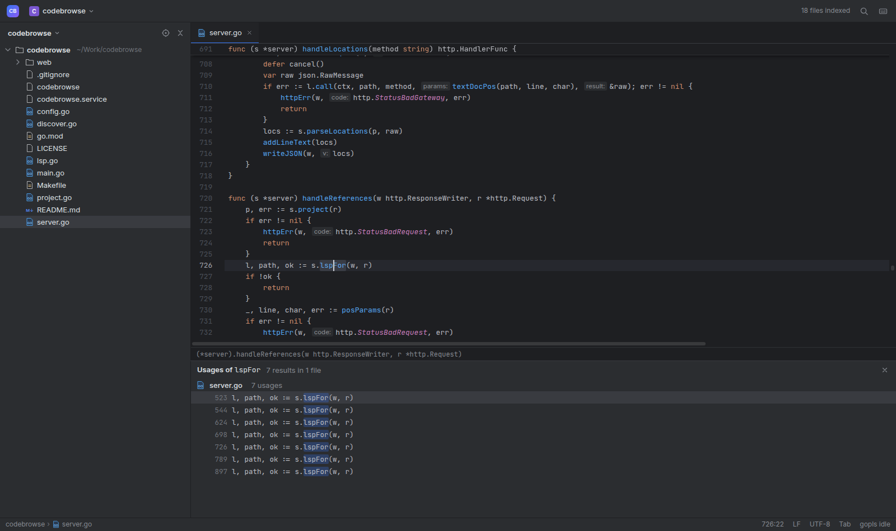
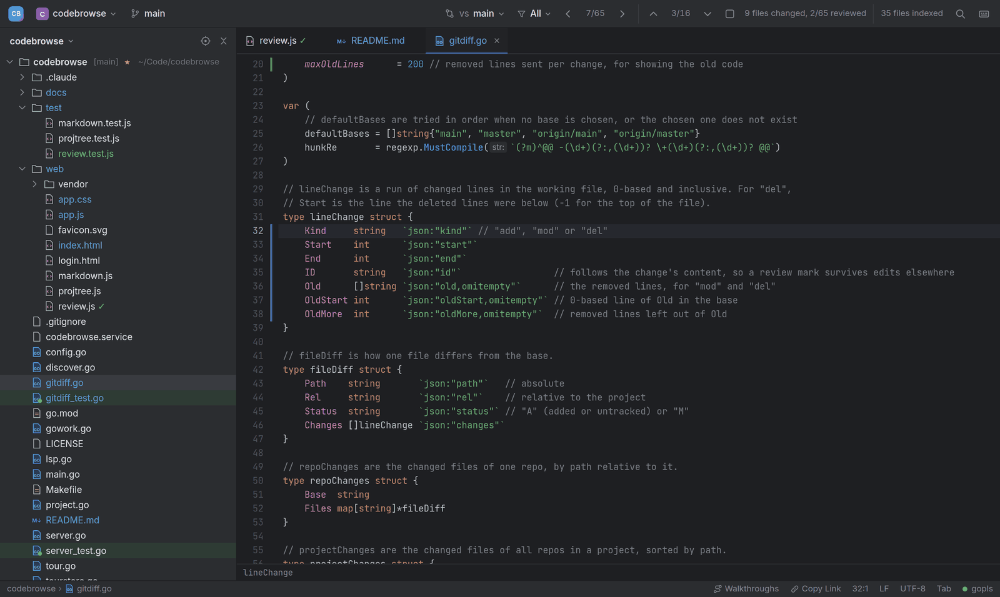
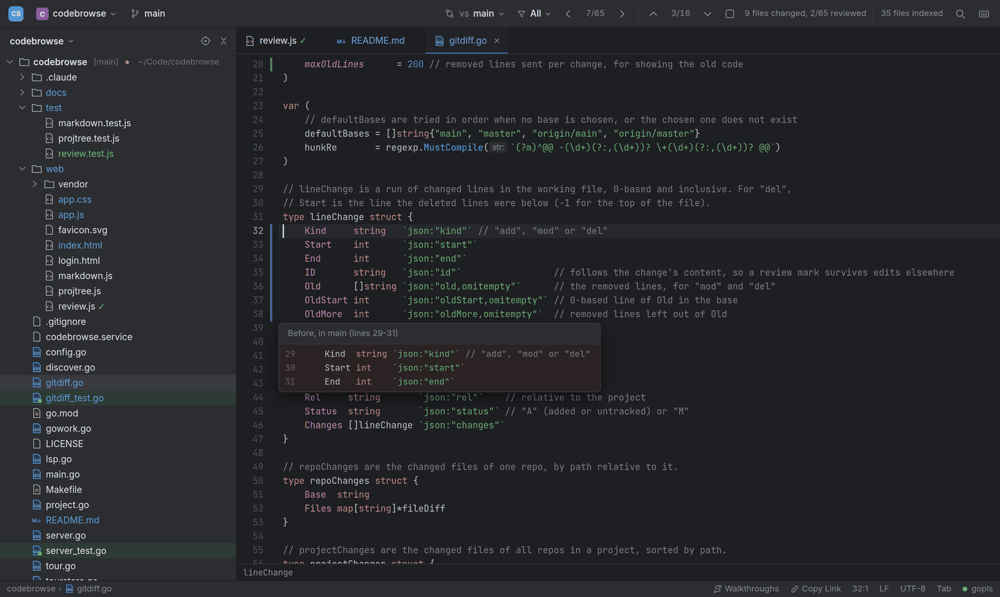
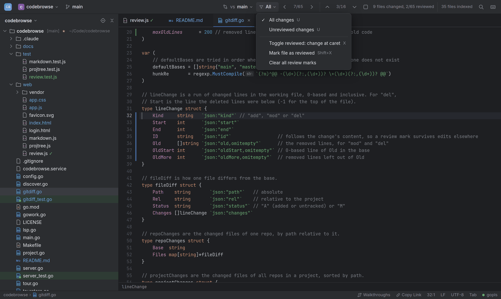

# codebrowse

A small, read-only, IntelliJ-style code browser for Go that runs in your browser. It's handy when your code lives on a remote dev box or VM and you want to read it, jump around and find usages without starting an IDE.



It is a single Go binary with no dependencies outside the standard library. The frontend is embedded and written in plain JavaScript with no build step. The only third-party code is a vendored copy of Mermaid, which is loaded when a Markdown preview shows a diagram. All navigation comes from [gopls](https://pkg.go.dev/golang.org/x/tools/gopls), Go's language server, so go-to-definition and find-usages are type-accurate, including across modules in a `go.work` and into the standard library or module cache.

## Features

- **Ctrl+Click** goes to the declaration. Ctrl+Click on a declaration shows its usages instead.
- **Ctrl+G** shows the usages of the symbol at the caret in a pane at the bottom. If there is exactly one usage, it jumps straight there.
- **Ctrl+B** goes to the declaration and **Ctrl+Alt+B** goes to the implementations.
- **Alt+←/→** (or the mouse back button) goes back and forward. Every jump is a browser history entry.
- **Double Shift / Ctrl+P** searches for files. Press Tab to switch to workspace symbols or the current file's structure. You can type `name:123` or `:123` to go to a line.
- **Ctrl+E** shows recent files, **Ctrl+F12** shows the file structure, **Alt+F1** selects the open file in the tree, and **Esc** closes popups.
- **Display:**
  - IntelliJ "New UI" dark theme with semantic highlighting.
  - Parameter-name hints (`msg:`), hover docs, and highlighting of every occurrence of the symbol at the caret.
  - The enclosing function header stays pinned at the top while you scroll.
- **Project tree:**
  - Shows the git branch of every repo or worktree folder, with a ★ if it has uncommitted changes to tracked files.
  - Hides `.git`, `node_modules`, gitignored paths and generated files (`// Code generated ... DO NOT EDIT.`). The project menu can show them again.
- **Projects:**
  - Added from the project dropdown, or discovered automatically from globs such as `~/src/*`.
  - The project dropdown shows them as a folder tree, so nested repos and workspaces stay grouped.
  - Indexed in the background and re-indexed periodically. gopls is told when files change on disk.

- **Deep links**:
  - The address bar always shows a link to where you are.
  - Click a line number to highlight that line. Shift+click extends the range and Ctrl+click adds another one, as on GitHub.
  - **Copy Link** in the status bar, or Alt+Shift+C, copies a link to the highlighted lines, the selection or the caret line.
- **Walkthroughs**: one link opens a step-by-step tour through the code. See [Walkthroughs](#walkthroughs).
- **Markdown preview**: as in IntelliJ, the buttons at the top right of a Markdown file switch between source, side by side and rendered.
  - Renders GitHub-flavoured Markdown: tables, task lists, fenced code with syntax highlighting, images from the repo, and [Mermaid](https://mermaid.js.org) diagrams.
  - In side-by-side mode the two panes scroll together, and the divider can be dragged.
  - Relative links open the file in codebrowse; `file.go#L10-L20` highlights those lines and `other.md#section` jumps to that heading.
  - The last mode you picked is used for the next Markdown file you open.
- **Changes against main**, as in IntelliJ:
  - Thin bars next to the line numbers mark lines added (green) or changed (blue) on your branch, and a grey wedge marks deleted lines.
  - Changed files are colored in the tree and tabs, and so are the folders that contain them.
  - The left/right arrows at the top right (or **Alt+↓/↑**, **F7** / **Shift+F7**) jump to the next or previous change across all files and reveal the file in the tree. The up/down arrows next to them (or **Ctrl+Alt+Shift+↓/↑**) cycle through the changes in the open file. Each shows where you are, e.g. `2/27`.
  - Review marks, like GitHub's "Viewed": **X** or **Y** (or the checkbox next to the up/down arrows) checks off the change at the caret and jumps to the next unreviewed one ("No more changes" when none are left), **Shift+X** / **Shift+Y** does the same for the whole file; press again on a checked change to clear it. Reviewed changes get a faint gutter bar, fully reviewed files a check in the tree and tabs, and the top bar counts e.g. `3/12 reviewed`. A mark follows the change's content, so it stays when other lines move and clears when the change itself is edited. Marks are kept in the browser, per project.
  - Hover the blue or gray gutter marker of a change (or click it, or press **D** with the caret in the change) to see the old code from the base branch in a popup.
  - The filter left of the arrows (or **U**) switches between stepping through all changes and only the unreviewed ones, for a review done entirely from the keyboard: read, **X**, read, **X**, ...
  - The comparison is against where your branch left `main` (or `master`, `origin/main`, `origin/master`), including uncommitted edits; on `main` itself it shows uncommitted edits only. The "vs main" dropdown next to the arrows picks another branch, remembered per project.
- **Zoom**: Ctrl+Scroll (or pinch) over the editor or the Markdown preview zooms just that pane, not the whole page. Ctrl+0 resets it.

| Changes and review marks | Old code of a changed section | Review filter |
|---|---|---|
| [](docs/review-changes.png) | [](docs/review-oldcode.png) | [](docs/review-filter.png) |

Other file types (YAML, JS/TS, SQL, proto, …) get basic syntax highlighting but no navigation.

When a project root holds several Go modules but no `go.work` (for example a directory of checked-out repos), codebrowse generates a `go.work` covering every module inside a git checkout. It points gopls at that file, so navigation and usages work across the repos.

## Deep links

```
http://host:7878/#p=<project>&f=<file>&l=<lines>
```

| Param | Meaning |
| --- | --- |
| `p` | Project id: the slugified folder name, for example `my-repo`. Optional if `f` is absolute; the project is then inferred from the path. |
| `f` | File path, absolute or relative to the project root. URL-encode it. |
| `l` | Lines to highlight: `42`, `10-20`, or several ranges such as `10-20,31,40-45` (`L10-L20` also works). The view jumps to the first range. |
| `c` | A line to place the caret on without highlighting it. The address bar uses this when nothing is highlighted. |

## Walkthroughs

A walkthrough is a list of steps, each a file plus line ranges plus a Markdown note. It opens in the bottom panel. Next/Prev (or F8 / Shift+F8) jump to each step and highlight its lines, and the steps are numbered in the gutter. It doesn't take over the editor: you can still browse, Ctrl+Click and Ctrl+G between steps, then press Next to continue. The current step is part of the URL, so reloading or sharing the link keeps your place. Every step is a history entry, so Back works too.

A walkthrough is written as JSON:

```json
{
  "title": "How a request is handled",
  "project": "my-service",
  "steps": [
    {
      "title": "Routing",
      "file": "cmd/server/main.go",
      "lines": "40-72",
      "note": "`main` wires the router.\n\n- At [line 58](L58) the `/orders` routes are registered.\n- Middleware is set up in [newRouter](internal/http/router.go:12)."
    },
    {
      "title": "The handler",
      "file": "internal/http/orders.go",
      "lines": "88-131,140-152"
    }
  ]
}
```

| Field | Meaning |
| --- | --- |
| `title` | Shown in the panel header and status bar. |
| `project` | Project id, name or path. Optional when the step files are absolute paths. |
| `steps[].title` | Short step name for the step list. |
| `steps[].file` | Path relative to the project root, or absolute. |
| `steps[].lines` | Ranges to highlight, same syntax as `l` in deep links. The first range is where the step lands. |
| `steps[].note` | Markdown: paragraphs, `-` and `1.` lists, `` `code` ``, `**bold**`, links. A link to `L42` or `L42-L50` jumps within the step's file; `path/file.go:42` jumps elsewhere. |

To turn the JSON into a link, pipe it into `codebrowse tour`. The command checks that every file exists and every line range is inside the file, and prints the URL:

```sh
codebrowse tour < tour.json
# http://devbox:7878/#tour=<compressed tour>
```

Every tour created this way is also saved to `~/.config/codebrowse/tours/`, and appears in the **Walkthroughs** list. To open the list, click Walkthroughs in the status bar or the Walkthroughs tab of the bottom panel. Pass `-no-save` to only print the link.

The JSON is compressed (raw deflate + base64url), so a tour with 7 steps and short notes fits in about 2 KB. The links work in any browser that can reach the server. Set `public_url` in the config so the printed links use the right host name. You can also put the JSON in the link uncompressed: `#tour=<URL-encoded JSON>`.

## Requirements

- Linux with systemd (user services). macOS works if you run the binary directly.
- Go 1.24+ and `git`.
- gopls: `go install golang.org/x/tools/gopls@latest`.

## Install

```sh
git clone https://github.com/binwiederhier/codebrowse
cd codebrowse
make install    # builds, installs ~/.local/bin/codebrowse, enables + starts the systemd user service
make password   # prints the generated login password
```

Then open http://127.0.0.1:7878 and add a project.

Prebuilt binaries for Linux and macOS (amd64 and arm64) are on the [releases page](https://github.com/binwiederhier/codebrowse/releases). Put `codebrowse` on your PATH and run it directly; `make install` is only needed for the systemd service.

To keep the service running after you log out of the machine, enable lingering: `loginctl enable-linger $USER`.

Other targets: `make restart` rebuilds and restarts, `make logs` follows the journal, and `make uninstall` removes the binary and the unit. Uninstall leaves the config in place.

## Configuration

The config file is `~/.config/codebrowse/config.json`. It is created on first start; restart the service after editing it.

```json
{
  "listen": "127.0.0.1:7878",
  "password": "generated-on-first-start",
  "secret": "generated-on-first-start",
  "projects": [
    { "id": "myproject", "name": "myproject", "path": "/home/me/src/myproject" }
  ],
  "discover": ["~/src/*", "~/work"],
  "hidden": []
}
```

| Key | Meaning |
| --- | --- |
| `public_url` | Base URL used in links printed by `codebrowse tour`, for example `http://devbox:7878`. Defaults to the hostname plus the listen port. |
| `listen` | Address to listen on. The default only accepts local connections; use `0.0.0.0:7878` to reach it from another machine. |
| `password` | Login password. Changing it logs out all sessions. |
| `secret` | HMAC key for the session cookie. Don't share it. |
| `projects` | Projects added by hand, through the UI or this file. |
| `discover` | Globs. Every matching directory becomes a project; this is checked every 30s. |
| `hidden` | Discovered directories you removed from the project list. |

Resource use:
- **Indexing:** a project is not indexed until you first open it, and stops re-indexing after 30 minutes without use.
- **gopls:**
  - At most 2 gopls processes run at once, each capped with `GOMEMLIMIT=2GiB`.
  - An idle gopls process exits after 45 minutes.
  - A large `go.work` can use 1-2 GB.

## Security

codebrowse serves source code, so treat it like SSH access:

- Every page and API call needs the password. After login, a session cookie lasts 90 days.
- Files can only be read inside a configured project, `GOROOT` or `GOMODCACHE`.
- There is **no TLS**. If you bind to `0.0.0.0`, the password and your code travel unencrypted. Prefer `127.0.0.1` plus an SSH tunnel (`ssh -L 7878:localhost:7878 devbox`), or put it behind a TLS reverse proxy.
- Anyone who can log in can add any directory the service user can read as a project.

## Development

How it works inside, with diagrams: [docs/](docs/README.md) ([architecture](docs/architecture.md), [frontend](docs/frontend.md)).

```sh
go build -o codebrowse . && ./codebrowse -config /tmp/cb.json   # run a dev instance with its own config
make test                                                       # go vet, Go tests and the Markdown renderer tests (node --test)
make restart                                                    # deploy to the user service
```

| File | Purpose |
| --- | --- |
| `main.go`, `config.go` | Flags, config file, startup. |
| `server.go` | HTTP routes, auth and the JSON API. |
| `project.go` | Indexing, ignore rules, git branch/dirty status, fuzzy file search. |
| `discover.go` | Project auto-discovery. |
| `lsp.go` | A minimal LSP client for gopls (JSON-RPC over stdio). |
| `gowork.go` | The generated `go.work` for directories of repos. |
| `tour.go` | `codebrowse tour`: validates a walkthrough and prints its link. |
| `web/` | The UI: `index.html`, `app.css`, `app.js`. |
| `web/markdown.js` | The Markdown preview renderer and its HTML sanitizer. Tests are in `test/`. |
| `web/projtree.js` | Groups the project list into the folder tree of the project menu. Tests are in `test/`. |
| `web/review.js` | Change navigation and review marks. Tests are in `test/`. |
| `web/vendor/` | Mermaid (MIT), vendored as a single file so diagrams render without internet access. |

## Instructions for Claude (AI coding agents)

If a user asks you to install or set up codebrowse for them, do the following:

1. **Check prerequisites.**
   - Run `go version` and `git --version`, and check for gopls with `command -v gopls || ls ~/go/bin/gopls`.
   - If gopls is missing, ask the user before installing it with `go install golang.org/x/tools/gopls@latest`.
   - If `systemctl --user` doesn't work (for example on macOS or in a container), skip the service: build with `go build -o codebrowse .` and tell the user how to run it.
2. **Ask the user two things.**
   - **Network access.** Will they open it from the same machine or over an SSH tunnel? Then keep `127.0.0.1:7878`. If they want to open it from another machine directly, use `0.0.0.0:7878`, and tell them it's password-protected but unencrypted HTTP.
   - **Projects.** Which directories hold their code? Single repos or workspaces become `projects` entries. Parent directories whose subfolders should each be a project become `discover` globs such as `~/src/*`.
3. **Install.**
   - Clone the repo (or use the current checkout) and run `make install`. This creates `~/.config/codebrowse/config.json`.
   - Edit that file to set `listen`, `discover` and/or `projects`. Keep the generated `password` and `secret`.
   - Run `systemctl --user restart codebrowse`.
4. **Keep it running after logout.**
   - Check `loginctl show-user $USER -p Linger`.
   - If it says `Linger=no`, offer to run `loginctl enable-linger $USER`. It may need sudo.
5. **Verify.**
   - Check that `systemctl --user is-active codebrowse` reports `active`.
   - Run `journalctl --user -u codebrowse -n 20` and look for an `indexed project` line.
   - Log in with `curl -s -c /tmp/cb.cookies -d password=$(~/.local/bin/codebrowse -print-password) http://127.0.0.1:7878/login`.
   - Then `curl -s -b /tmp/cb.cookies http://127.0.0.1:7878/api/projects` should list the projects.
6. **Report back.** Give the user the URL, the password (`make password`), and the key shortcuts: Ctrl+Click, Ctrl+G, Double Shift, Alt+←.

### Showing code to the user

When codebrowse is installed and you explain code to the user, link to it instead of quoting file paths:

- **One spot**: a deep link such as `http://host:7878/#p=<project>&f=<url-encoded path>&l=<lines>`. Get the project ids from `GET /api/projects` (needs the login cookie) or `~/.config/codebrowse/config.json`; a discovered project's id is its folder name, lowercased, with runs of other characters turned into dashes.
- **A flow across several places** (a request path, a data flow, how a feature works, a review): write a walkthrough JSON and run `codebrowse tour < tour.json`. Give the user the printed link along with your normal answer.
  - One step per stop, in reading order.
  - Use `lines` that cover the whole function or block being discussed, plus extra ranges for the specific spots.
  - Put the explanation for that stop in `note`, and use `[label](L123)` links for lines you mention.
  - Keep notes short. The code is right next to them.
- **Always verify line numbers.** Read the files first. `codebrowse tour` refuses ranges that don't exist, but it can't tell when a range points at the wrong function.

When changing the code:
- The backend is stdlib-only Go and the frontend is dependency-free JavaScript (apart from the vendored Mermaid). Keep it that way; don't add npm packages or Go modules without asking.
- Run `make test` before `make restart`.
- To check UI changes, drive a real browser (for example with Playwright) against a dev instance on another port. Don't only reason about the code.

## License

Apache 2.0, see [LICENSE](LICENSE).
