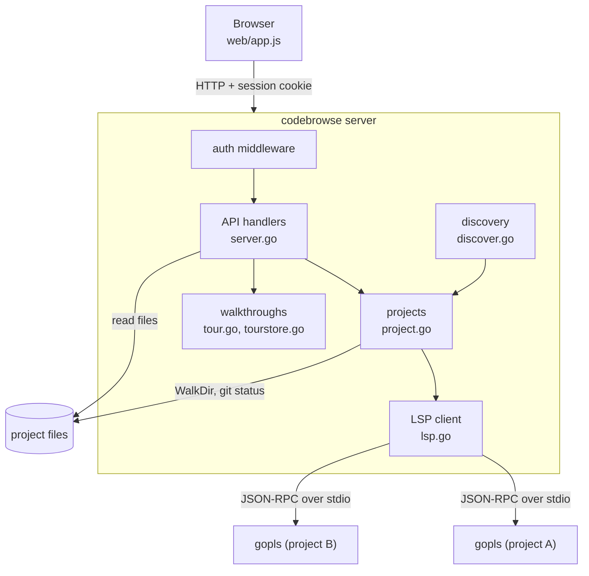
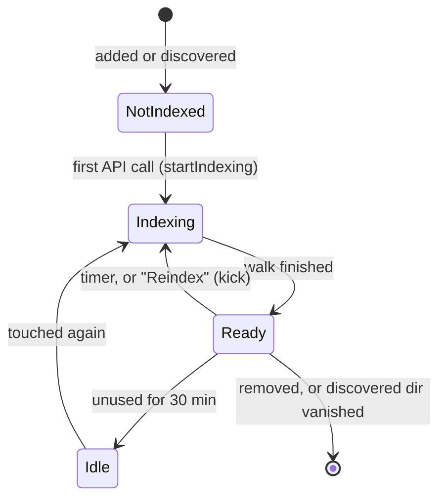
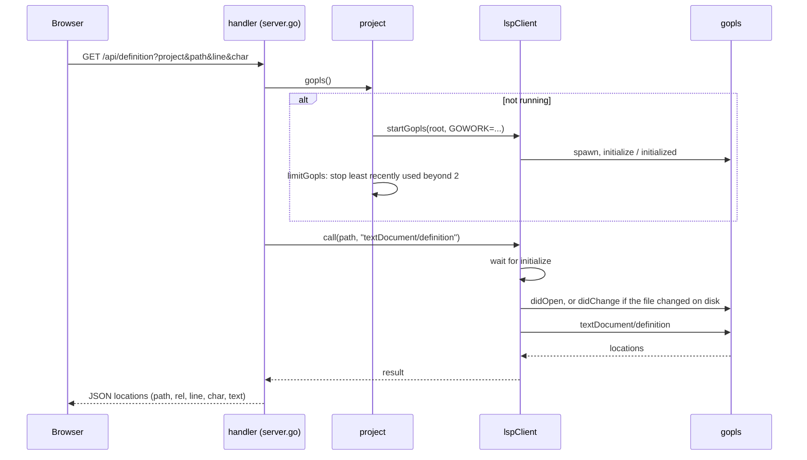
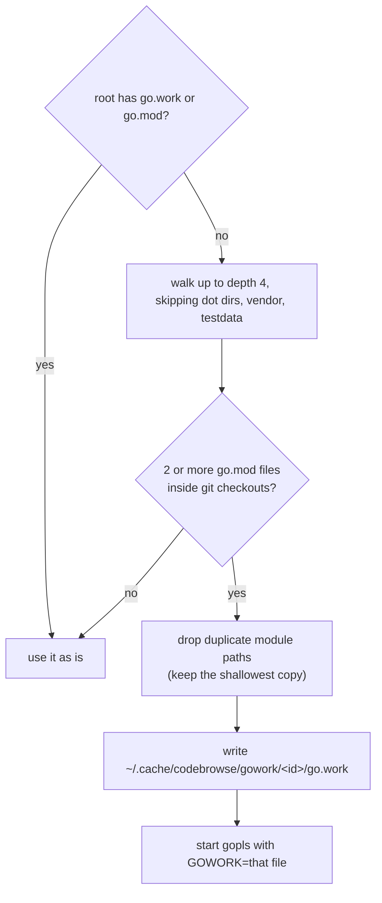
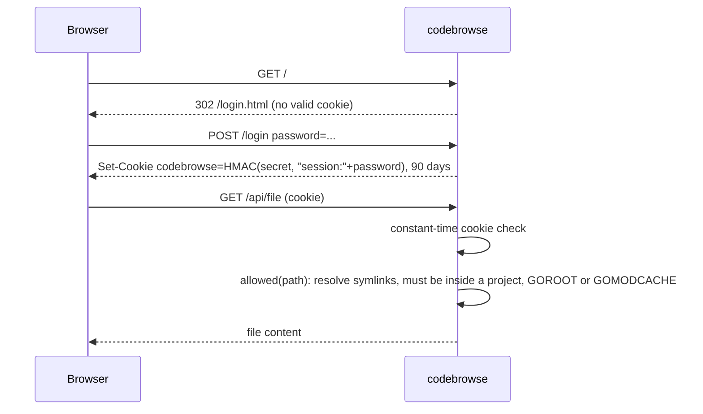

# Architecture

codebrowse is one Go binary (stdlib only) that serves an embedded single-page UI and a small JSON API. All code intelligence comes from [gopls](https://pkg.go.dev/golang.org/x/tools/gopls), which codebrowse runs as a child process per project and talks to over LSP (JSON-RPC on stdin/stdout).

## Source files

| File | Responsibility |
| --- | --- |
| `main.go` | Flags, `codebrowse tour` subcommand dispatch, starts discovery, the gopls reaper and the HTTP server. |
| `config.go` | `~/.config/codebrowse/config.json`: load, generate the password/secret on first start, save. |
| `server.go` | Routes, auth, path checks, and every `/api/*` handler. |
| `project.go` | Indexing (file tree, ignore rules, git status), fuzzy file search, gopls lifecycle per project. |
| `lsp.go` | A minimal LSP client: process start, request/response matching, document sync. |
| `discover.go` | Turns directories matching the `discover` globs into projects, every 30s. |
| `github.go` | GitHub pull requests. `parsePRRef` reads links and `owner/repo#n`; `fetchPR` calls the API; `checkoutPR` fetches `refs/pull/<n>/head` and the base branch into a bare cache repo per GitHub repo (`~/.cache/codebrowse/github/<owner>/<repo>.git`) and checks the head out, detached, into a worktree per PR (`.../<repo>/pr-<n>`). The PR becomes a project with `projectConfig.PR` set, saved in the config. `githubToken(r)` is the one place GitHub credentials come from (config `github_token`, else `gh auth token`), and the seam for per-user GitHub sign-in later (plan: `~/Code/plans/261015-codebrowse-github-prs.md`). |
| `gitdiff.go` | Changes against a base branch (one `git diff -U0` per repo) and the branch list. A chosen base that a repo lacks, or that starts with `-`, falls back to the default. |
| `gowork.go` | Generates a `go.work` for a root that holds several modules but no `go.work`. |
| `tour.go`, `tourstore.go` | `codebrowse tour` (validate a walkthrough, print its link) and the saved-tour list. |
| `web/` | The embedded UI. See [frontend.md](frontend.md). |

## Projects and indexing

A project is a directory, either listed in the config or found by a `discover` glob. Discovered projects cost nothing until someone opens them: the first API call that names a project starts its index loop (`startIndexing`, guarded by a `sync.Once`).

One index pass (`project.index`) walks the tree with `filepath.WalkDir` and builds:

- `dirs`: the children of every directory, for the project tree.
- `files`: every non-ignored file, for fuzzy search (`find`).
- `git`: branch and dirty flag of every repo or worktree root (`git status --porcelain=v2`).
- `stats` and `gen`: size/mtime of Go files, and whether each is generated (cached by stat, so a re-index only re-reads changed files).

Entries are hidden (but kept, so the UI can show them on request) when they are `.git`, `node_modules` or `.cache`, gitignored (`git ls-files -o -i --exclude-standard`), or generated Go files (`// Code generated ... DO NOT EDIT.`).

The loop waits at least 60s between passes, or 10x the time the last pass took, so huge trees don't spin. After the first pass, every re-index diffs the Go file stats and sends `workspace/didChangeWatchedFiles` to gopls, so gopls notices edits made outside codebrowse.

## gopls

gopls is started lazily, by the first request that needs it (`project.gopls()`), with `GOMEMLIMIT=2GiB` and the project root as working directory.

Limits that keep memory in check:

- At most **2** gopls processes run at once (`maxGopls`). Starting a third stops the least recently used one.
- The reaper stops a gopls that has been idle for **45 minutes** (`goplsIdleLimit`).
- The LSP client keeps at most **40** documents open in gopls (`maxOpenDocs`) and closes the oldest.

Documents are synced by stat: before each request, `sync` compares the file's size and mtime with what gopls last saw, and re-sends the full content if it changed. codebrowse never edits files, so full-content sync is enough.

### Generated go.work

A directory of checked-out repos has several `go.mod` files and no `go.work`. gopls would treat each module separately, so cross-repo navigation and usages would not work. `syntheticGoWork` handles this:

## Auth and file access

- The session token is derived from the password, so changing the password logs everyone out.
- Every file path from the client must be absolute and is checked by `allowed` after resolving symlinks.
- `/api/raw` (images for the Markdown preview) additionally only serves image types, with `Content-Security-Policy: sandbox` and `nosniff`, so an SVG or HTML file in a repo can't run script in codebrowse's origin.
- There is no TLS; see Security in the main README.

## HTTP API

All endpoints need the session cookie. Paths are absolute; `line` and `char` are 0-based LSP positions, passed through to gopls unchanged.

| Route | Parameters | Returns |
| --- | --- | --- |
| `GET /api/projects` | | Projects with id, name, path, index state and file count. |
| `POST /api/projects` | JSON body `{path, name}` | Adds a project to the config (`~/` is expanded). |
| `DELETE /api/projects` | `project` | Removes it; a discovered one is added to `hidden` so it stays gone. |
| `POST /api/projects/settings` | `project`, `show_ignored` | Toggles showing ignored files (persists a discovered project to the config). |
| `POST /api/projects/reindex` | `project` | Kicks a re-index now. |
| `GET /api/complete` | `path` | Directory completions for the Add Project dialog. |
| `GET /api/status` | `project` | Index state, version, file count, gopls status, root branch and dirty flag. |
| `GET /api/tree` | `project`, `dir` | Children of a directory. |
| `GET /api/find` | `project`, `q` | Fuzzy file matches. |
| `GET /api/file` | `project`, `path` | Content, display path, branch, mtime; `binary` for non-text or files over 8 MB. |
| `GET /api/raw` | `project`, `path` | Image bytes, for the Markdown preview. |
| `GET /api/changes` | `project`, `base`, `whitespace` | Every changed file of every repo in the project, with status (`A`/`M`) and line runs (`add`, `mod`, `del`, each with a content `id` and the removed lines), against where HEAD forked from `base` (default: `main`, `master`, `origin/main` or `origin/master`). Untracked files count as added. Whitespace changes are ignored unless `whitespace=1`. |
| `GET /api/branches` | `project` | Local, then remote branches of all repos in the project, for picking `base`. Empty for a pull request, whose base is fixed. |
| `POST /api/github/pr` | JSON `{"ref"}`: a PR link or `owner/repo#n` | Fetches the PR and checks it out as a project (or updates the checkout), returns the project. 404 if GitHub does not know the PR or the token cannot read it. |
| `GET /gh/<owner>/<repo>/pull/<n>` | | Redirects to `/#gh=<owner>/<repo>/<n>`, which the web app opens. Signed out, the login page brings you back to it. |
| `GET /api/semantic` | `project`, `path` | gopls semantic tokens (+ legend). |
| `GET /api/hints` | `project`, `path` | Parameter-name inlay hints. |
| `GET /api/symbols` | `project`, `path` | Document symbols (structure, sticky header, breadcrumbs). |
| `GET /api/wsymbols` | `project`, `q` | Workspace symbol search. |
| `GET /api/definition`, `/implementation`, `/typedefinition` | `project`, `path`, `line`, `char` | Locations. |
| `GET /api/references` | `project`, `path`, `line`, `char`, `decl` | Usages sorted by path and line, each with its line text. |
| `GET /api/hover` | `project`, `path`, `line`, `char` | Hover docs as Markdown. |
| `GET /api/highlights` | `project`, `path`, `line`, `char` | Occurrences of the symbol at the caret. |
| `GET /api/tours`, `DELETE /api/tours` | `id` (delete) | Saved walkthroughs. |
