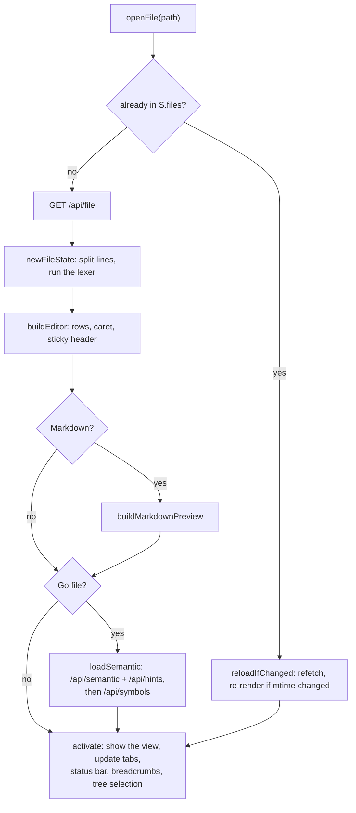
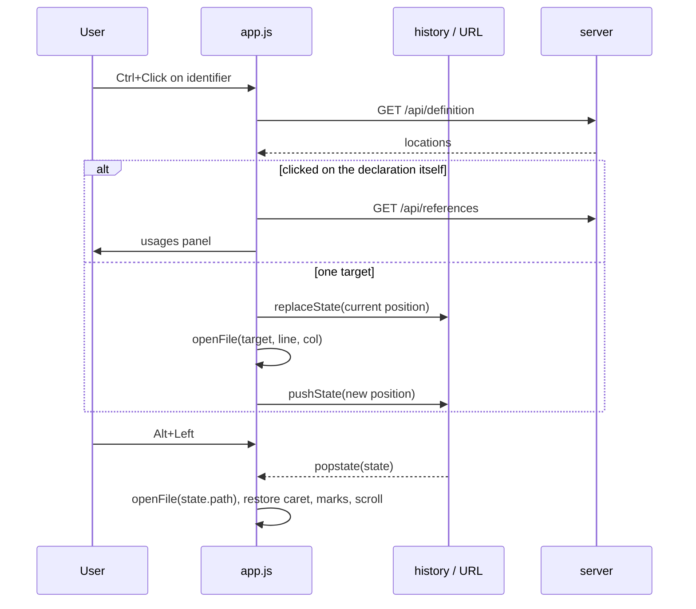
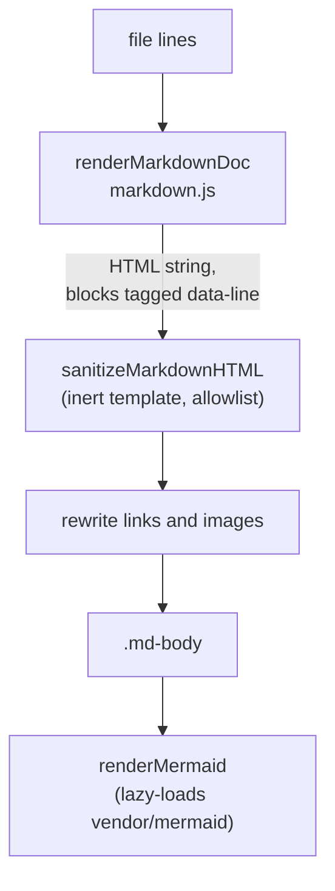

# Frontend

The UI is plain JavaScript with no build step, embedded into the binary from `web/`:

| File | Contents |
| --- | --- |
| `index.html` | The layout: top bar, project tree, tabs, editor area, bottom panel, status bar. |
| `app.css` | IntelliJ "New UI" dark theme, editor rows, Markdown preview styles. |
| `app.js` | Everything else: state, lexers, editor, navigation, walkthroughs, preview, zoom. |
| `markdown.js` | The Markdown preview renderer and its HTML sanitizer (tested in `test/`). |
| `vendor/mermaid-*.min.js` | Mermaid, loaded on demand when a preview contains a diagram. |

## State

All UI state lives in one object, `S`, in `app.js`:

| Field | Meaning |
| --- | --- |
| `projects`, `pid` | All projects, and the id of the open one. |
| `files` | Open files by absolute path, each with its lines, lexer tokens, gopls data, caret and DOM nodes. |
| `tabs`, `active`, `recent` | Tab order (max 20), the visible file, and recently opened files. |
| `tree`, `expanded`, `treeSel` | Loaded directory listings and which folders are open. |
| `status` | The last `/api/status` result (index and gopls state). |

Tabs, carets, recent files and expanded folders are saved per project in `localStorage` (`saveSession`), so a reload restores the workspace. `/api/status` is polled every 1.5s while indexing or gopls is busy and every 8s otherwise; a new index version refreshes the tree, and gopls becoming ready retries files whose semantic highlighting had failed.

## Opening a file

Each open file owns a `.fview` element in `#editorWrap`; only the active one is displayed. Inside it is the `.code-scroll` editor and, for Markdown files, the preview, its splitter and the mode buttons.

### Highlighting layers

A line's HTML (`lineHTML`) is built from up to three layers, later ones winning:

1. **Lexer tokens**, available instantly: `lexGo` for Go, `lexGeneric` with a per-language table (`LANGS`) for everything else.
2. **Semantic tokens** from gopls (`/api/semantic`), decoded into per-line spans with classes like `s-function m-definition`. Identifier spans get the `tk` class, which makes them Ctrl+Click targets.
3. **Inlay hints** (`/api/hints`), inserted as `.hint` spans before the character they belong to.

Rows have a fixed height (`LH`, from the `--lh` CSS variable), so scrolling, the sticky function header and line math are simple multiplications. Columns are measured from the DOM (`domPos`, `posFromPoint`), so they stay correct with any font.

## Navigation and deep links

Every navigation is a browser history entry, so Back and Forward (Alt+Left/Right, the mouse back button) work everywhere:

The URL hash always mirrors the current position (`#p=<project>&f=<path>&l=<lines>`), and is updated with `replaceState` 400ms after the caret stops moving. Highlighted line ranges (`marks`) come from clicking line numbers or from the `l` parameter.

## Walkthroughs

A walkthrough travels in the URL as `#tour=<value>`: either URL-encoded JSON or base64url of raw-deflated JSON (`DecompressionStream('deflate-raw')`). The bottom panel shows its steps; each step is a history entry, and the step number is part of the hash, so reloads and shared links keep their place. Step notes use the small `renderMarkdown` in `app.js` (also used for hover docs), which supports `[label](L42)` and `[label](file.go:42)` code links. Saved tours come from `GET /api/tours`.

## Markdown preview

Markdown files get three modes, switched with the buttons at the top right of the file: source, side by side, and rendered. The last mode picked is the default for files opened later; a deep link with highlighted lines switches a rendered-only file to side by side so the lines are visible.

- **Rendering.** `renderMarkdownDoc` parses blocks (headings, lists, task lists, tables, quotes, fenced and indented code, raw HTML, reference definitions), then inline syntax. Inline code, links and raw tags are swapped for placeholders first, so later passes (emphasis, bare URLs) can't corrupt them. Code fences are highlighted with the editor's lexers via the `highlight` callback.
- **Sanitizing.** Raw HTML from the file passes through the renderer, so the result is parsed into an inert `<template>` and filtered: scripts, styles, iframes, forms and the like are removed, unknown tags are unwrapped, only allowlisted attributes survive, and `javascript:`/`data:` URLs are dropped (except `data:image/` for images). `id` and `name` become `data-anchor` so they can't clash with the app's own ids.
- **Links and images.** Relative links are resolved against the file (or the project root for `/path`) and become codebrowse deep links, so middle-click and copying work; a plain click opens the file in place, with `#L10-L20` highlighting lines and `#heading` scrolling to an anchor. Relative images load through `/api/raw`.
- **Mermaid.** `mermaid` code blocks render as diagrams with the dark theme and `securityLevel: 'strict'`. The library (~3.5 MB) is only loaded once an open Markdown file contains a diagram, renders are queued one at a time (`mermaid.render` is not reentrant), and SVGs are cached by source text so re-rendering after a file change is quick. A diagram with a syntax error shows the parser message above its source.
- **Scroll sync.** In side-by-side mode, `syncScroll` maps between editor lines and preview pixels by interpolating between the `data-line` attributes of rendered blocks, in both directions. A short lock stops the two scroll handlers from feeding back into each other.

## Zoom

Ctrl+Scroll (or a trackpad pinch) over the editor or the preview zooms that pane instead of the browser page, like IntelliJ's "Change font size with Ctrl+Mouse Wheel". Ctrl+0 resets the focused pane.

- **Editor:** changes the font size (8 to 32px, default 13px). `LH` and the `--lh`/`--code-size` CSS variables follow it, the line under the mouse stays in place, and hidden tabs refresh their caret and highlights when next shown (`refreshZoomed`).
- **Preview:** sets the CSS `zoom` of `.md-body` (50% to 300%), which scales text, images and diagrams together.

Both levels are global and remembered in `localStorage`.
